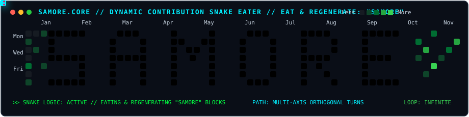

<div align="center">

  <!-- Morphing Glitch Cyber Banner -->
  

  <br/><br/>

  <!-- Dynamic Typing Terminal Header -->
  <a href="https://git.io/typing-svg">
    
  </a>

  <br/>

  <!-- Dynamic GitHub Contribution Snake Eating SAMORE Heatmap -->
  

  <br/><br/>

  <!-- High-Voltage Interactive Cyber-Deck Launch Hub -->
  <table border="0" style="border: none;">
    <tr>
      <td align="center">
        <a href="https://samore141025.github.io/samore141025/" target="_blank">
          
        </a>
      </td>
    </tr>
  </table>

  <p>
    <em>🎮 Click above to speak directly with <strong>SAMORE-AI</strong> (Web Speech Voice Synthesis) and play the <strong>8 Cyber Arcade Games</strong> (Snake, Hex Breach, Matrix Runner, DDoS Defense, and more)!</em>
  </p>

  <br/>

  <!-- Status Badges -->
  <p>
    
    
    
    
    
  </p>

</div>

---

### 🛡️ THE CODEX OF S.A.M.O.R.E.

> *"SAMORE is not merely an alias. It is an engineering doctrine forged for the next era of cyber intelligence and autonomous computing."*

| PROTOCOL | DOCTRINE PILLAR | CORE ARCHITECTURE & MISSION DIRECTIVE |
| :---: | :--- | :--- |
| 🟢 **`[ S ]`** | **SUSTAINABLE** | Resilient, low-energy AI architectures and green computing fault tolerance |
| 🔵 **`[ A ]`** | **AUTOMATION** | Multi-agent defense swarms, autonomous CI/CD, and self-healing threat pipelines |
| 🟡 **`[ M ]`** | **MANUFACTURING** | Industrial network infrastructure and high-reliability embedded systems (*Flash Electronics*) |
| 🟣 **`[ O ]`** | **OPTIMIZATION** | Model quantization, low-latency edge inference, and optical flow hyper-tuning |
| 🔷 **`[ R ]`** | **RESEARCH** | Space vision, remote sensing at *Bharatiya Antariksh Hackathon*, and *IEEE R&D* |
| 🔴 **`[ E ]`** | **EXPANSION** | Enterprise scale with *Red Hat OpenShift AI 2.13* and global hackathon leadership |

---

### 📊 REAL-TIME TELEMETRY & SYSTEM METRICS

<div align="center">
  <table border="0">
    <tr>
      <td width="50%" align="center">
        <a href="https://github.com/Samore141025">
          
        </a>
      </td>
      <td width="50%" align="center">
        <a href="https://github.com/Samore141025">
          
        </a>
      </td>
    </tr>
  </table>

  <br/>

  <a href="https://github.com/Samore141025">
    
  </a>
</div>

---

### 📁 CLASSIFIED DOSSIERS & CORE CAPABILITIES

<details open>
<summary><strong>🧠 SECTOR 01: ARTIFICIAL INTELLIGENCE & COMPUTER VISION</strong></summary>
<br/>

* **Specializations**: Deep Learning, TensorFlow, Object Detection, Convolutional Networks, Satellite Image Processing, Optical Flow.
* **Key Experience & Milestones**:
  * 🛰️ **Bharatiya Antariksh Hackathon**: Engineered Satellite Image Processing pipelines, Remote Sensing & Earth Observation models using Optical Flow algorithms.
  * 🎓 **EduSkills Academy**: AI-ML Intern developing Computer Vision, TensorFlow models, and high-precision object detection.
  * ☁️ **Google Cloud GenAI Academy APAC (Cohort 2)**: Prototyped and deployed Generative AI solution pipelines utilizing Google Cloud Run.
  * 📊 **Cognifyz Technologies & Deloitte**: Data Science intern operating Pandas, NumPy, Data Modeling, and Big Data analysis.

```bash
> Loaded Modules: [TensorFlow] [OpenCV] [Optical Flow] [Cloud Run] [Pandas] [NumPy]
```
</details>

<details open>
<summary><strong>🛡️ SECTOR 02: CYBER THREAT INTELLIGENCE & ETHICAL HACKING</strong></summary>
<br/>

* **Specializations**: Certified Ethical Hacker (CEH), Threat Hunting (CTH), Threat Intelligence (CTI), Multi-agent Systems, Malware Analysis, Penetration Testing, Kali Linux.
* **Key Experience & Milestones**:
  * 🛡️ **SHUGO**: Active researcher in Cyber Threat Intelligence (CTI), Orchestrator Defense, Cyber Threat Hunting (CTH), Unified Threat Management, and Guardian Intelligence.
  * 🎯 **EduSkills Academy**: Ethical Hacking Intern certified in Web Application Security, Network Penetration Testing, Vulnerability Assessment, and Social Engineering.
  * 🐧 **Tactical Tooling**: Kali Linux, Metasploit, Wireshark, Nmap, Burp Suite, Reverse Engineering.

```bash
> Security Clearance: [CEH Verified] [CTI Active] [Multi-Agent Swarm Defense]
```
</details>

<details>
<summary><strong>☁️ SECTOR 03: CLOUD, SYSTEMS & INDUSTRIAL IT</strong></summary>
<br/>

* **Specializations**: Enterprise Kubernetes & Containers, Red Hat OpenShift AI, AWS Infrastructure, Linux Systems Administration.
* **Key Experience & Milestones**:
  * 🔴 **Red Hat OpenShift AI**: Certified in *Introduction to Red Hat OpenShift AI (AI262F - RHA Ver. 2.13)* for enterprise AI/ML deployment.
  * ☁️ **AWS & Google Cloud**: AWS Cloud Practitioner Essentials, Google Cloud Run microservice orchestration.
  * 🏭 **Flash Electronics India Pvt Ltd**: Network and IT Administration Intern handling enterprise routing, system administration, and SAP integrations.

```bash
> Cloud Architecture: [OpenShift AI 2.13] [AWS Practitioner] [Linux SysAdmin] [Enterprise Routing]
```
</details>

<details>
<summary><strong>🎖️ SECTOR 04: LEADERSHIP, R&D & HACKATHONS</strong></summary>
<br/>

* **Community & Operational Command**:
  * ⚡ **Student Coordinator Head at ACES (NMIET)**: Headed team management, strategic leadership, and college-wide technical hackathons.
  * 🌐 **IEEE Member**: Active R&D participant, technological research papers, and technical event management.
  * 🏆 **Hackathons**: HackIndia Spark 6 @ NIT Delhi of Bellatrix, Gen AI Exchange Hackathon 2025 by Google Cloud, Social Summer of Code.

```bash
> Leadership Logs: [ACES NMIET Head] [IEEE R&D] [HackIndia Spark NIT Delhi]
```
</details>

---

### 🕹️ THE CYBER ARCADE PROTOCOLS (8 MINI-GAMES EMBEDDED)

You can launch and play all 8 games directly in the companion **[Cyber-Deck Terminal](https://samore141025.github.io/samore141025/)**:

| Protocol ID | Mini-Game | Classification | Mission Objective |
| :---: | :--- | :--- | :--- |
| **`MOD_01`** | **Cyber Snake** | Contributions | Consume green commits, expand the matrix streak, avoid firewalls |
| **`MOD_02`** | **Terminal Breach** | Cryptography | Crack the 4-digit hexadecimal security access key with parity hints |
| **`MOD_03`** | **Matrix Runner** | Reflex / Agility | Dodge cascading glitch debris in falling matrix data streams |
| **`MOD_04`** | **Memory Core** | Neural / Memory | Simon Says: repeat escalating 4-quadrant firewall defense signals |
| **`MOD_05`** | **DDoS Defense** | Defense / Blaster | Intercept and shoot down incoming malicious packet swarms |
| **`MOD_06`** | **Cipher Decode** | Cryptanalysis | Decrypt scrambled cybersecurity terms against a 30s countdown clock |
| **`MOD_07`** | **Cyber Invaders** | Space Retro | Repel descending waves of rogue AI daemons with pulse lasers |
| **`MOD_08`** | **Binary Pong** | AI Simulation | High-speed neon table pong against an adaptive firewall daemon |

---

### 📡 SECURE TRANSMISSION UPLINK

<div align="center">

| CHANNEL | DESTINATION | STATUS | TRANSMISSION UPLINK |
| :--- | :--- | :---: | :---: |
| ✉️ **Encrypted Email** | `shrikantashokmore@gmail.com` | `● ONLINE` | [**Transmit Email ↗**](mailto:shrikantashokmore@gmail.com) |
| 💼 **LinkedIn Network** | `linkedin.com/in/samore141025` | `● VERIFIED` | [**Connect on LinkedIn ↗**](https://www.linkedin.com/in/samore141025/) |
| 💻 **GitHub Protocol** | `github.com/Samore141025` | `● ACTIVE` | [**View GitHub Profile ↗**](https://github.com/Samore141025) |

<br/>

<a href="mailto:shrikantashokmore@gmail.com">
  
</a>
&nbsp;&nbsp;
<a href="https://www.linkedin.com/in/samore141025/" target="_blank">
  
</a>
&nbsp;&nbsp;
<a href="https://github.com/Samore141025" target="_blank">
  
</a>

<br/><br/>


</div>
